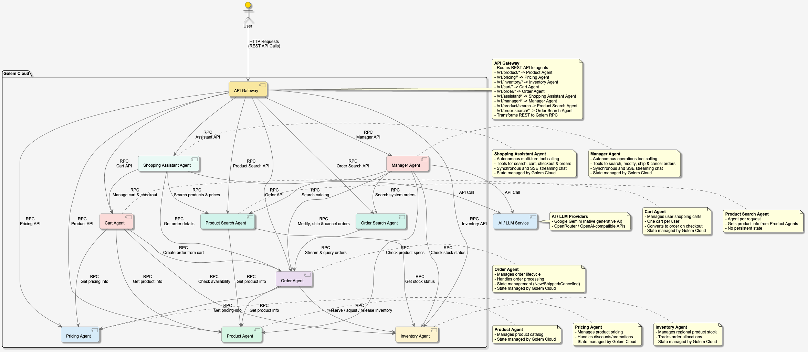

# golem-shopping-rust

## Overview
This is a simple e-commerce application built with an agent-based architecture, leveraging Golem Cloud for distributed, stateful agents. The application provides a complete online shopping experience with product browsing, cart management, order processing, and an AI-powered shopping assistant.



*Figure 1: Golem Shopping Application Architecture*

## Architecture Components

### Agents
- **Product Agent**: Manages the product catalog, details, and product metadata.
- **Pricing Agent**: Handles product pricing, currency conversions, volume discounts, and promotions.
- **Inventory Agent**: Manages regional product stock levels and order allocations, ensuring consistency during checkout and post-checkout order modifications.
- **Cart Agent**: Stateful per-user shopping carts that manage item additions, quantities, and cart-to-order conversions.
- **Order Agent**: Manages the end-to-end order lifecycle from checkout to fulfillment.
- **Product Search Agent**: Provides catalog search with flexible query filtering (keywords, brands, tags).
- **Order Search Agent**: Provides system-wide order search, filtering by status, user ID, or free-text query, and date sorting.
- **Shopping Assistant Agent**: Autonomous AI assistant that plans and executes multi-turn tool calling across domain agents using durable Golem RPC.
- **Manager Agent**: Autonomous AI assistant for store managers to search, modify, ship, and cancel orders, and inspect catalog/inventory.

### Key Features
- **RESTful HTTP API**: All agents expose HTTP endpoints declared in `golem.yaml` and mapped directly to agent methods.
- **Built-in Web Interfaces**: Zero-setup web clients served directly by Golem:
  - `/assistant`: Customer shopping assistant with real-time SSE streaming, collapsible tool inspection, and dynamic recommendations.
  - `/manager`: Store operations dashboard for searching, inspecting, modifying, shipping, and cancelling orders, plus inventory checks.
- **Storefront Frontend**: Vue 3 and Vite e-commerce storefront for product browsing, cart, and checkout.
- **Durable Execution & State**: State persistence, retries, and crash recovery are managed automatically by Golem Cloud.
- **Agent-to-Agent RPC**: Zero-boilerplate, type-safe RPC between agents with ambient context propagation.

---

## Quick Start

### 1. Prerequisites
- [Golem CLI](https://learn.golem.cloud/cli) (version 1.6.2+)
- Running Golem environment (local or cloud). See [Golem Quickstart](https://learn.golem.cloud/quickstart) for more information.

### 2. LLM Configuration
The Shopping Assistant requires an LLM provider configured in `golem.yaml` under `secretDefaults.local.llm`:

#### Option A: Google Gemini (Default)
Export your Gemini API key:
```bash
export GEMINI_API_KEY="your-gemini-api-key"
```
In `golem.yaml`:
```yaml
secretDefaults:
  local:
    llm:
      apiKey: '{{ GEMINI_API_KEY }}'
      model: "gemini-3.1-flash-lite"
      apiUrl: "https://generativelanguage.googleapis.com/v1beta"
```

#### Option B: OpenRouter
Export your OpenRouter API key:
```bash
export OPENROUTER_KEY="your-openrouter-key"
```
In `golem.yaml`:
```yaml
secretDefaults:
  local:
    llm:
      apiKey: '{{ OPENROUTER_KEY }}'
      model: "openrouter/anthropic/claude-3.5-sonnet"
      apiUrl: "https://openrouter.ai/api/v1"
```

### 3. Build and Deploy
```bash
# Build WASM components
golem build --yes

# Deploy to local Golem environment
golem deploy --yes
```

### 4. Import Sample Data
To populate the product catalog, pricing, and regional inventory, see the [Data README](./data/README.md).

From the `data/` directory:
```bash
HOST=http://localhost:9006 API_HOST=localhost:9006 drill --benchmark import.yaml --stats
```

### 5. Launch the Web Assistant Interface
The web client is hosted directly by Golem (no separate frontend server required). Open your browser and navigate to:
```
http://localhost:9006/assistant
```
Supports live SSE streaming, collapsible tool execution details, prompt reuse (`🔄`), error retry, dynamic product recommendations, and multi-user switching.

### 6. Launch the Store Manager Interface
The store management interface is hosted directly by Golem at `/manager`:
```
http://localhost:9006/manager
```
Empowers store managers to search, inspect, modify, cancel, and ship orders, and inspect catalog/inventory allocations with live SSE streaming and collapsible tool execution details.

### 7. Storefront Frontend (Vue 3)
A full e-commerce storefront for product browsing, cart management, and checkout is available in the [`frontend/`](./frontend) directory:
```bash
cd frontend
npm install
npm run dev
```
The application will be available at `http://localhost:3000`. See the [Frontend README](./frontend/README.md) for more details.
