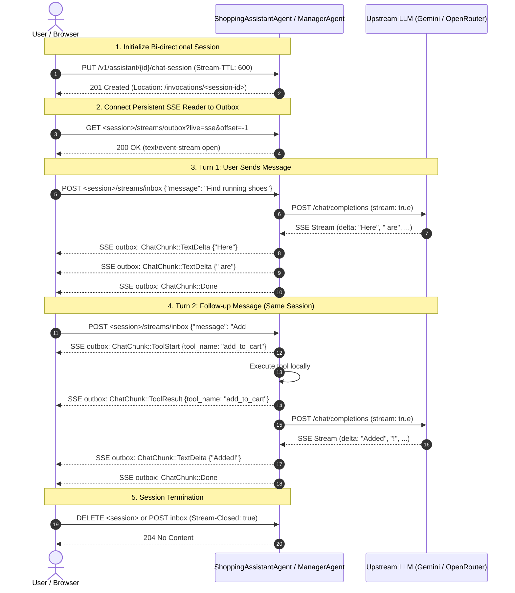

# Feature Plan: Bi-directional Chat Streaming with Input Stream & Live Token Streaming

- **Feature ID / Slug**: `bidirectional-chat-streaming`
- **Date**: 2026-11-03
- **Status**: Completed

---

## 1. Overview & Goals

Currently, the chat streaming implementation in [`src/shopping_assistant/mod.rs`](../../src/shopping_assistant/mod.rs) and [`src/manager/mod.rs`](../../src/manager/mod.rs) operates on a **per-turn, request-response basis**:
1. The client invokes `PUT /v1/assistant/{id}/chat-stream` with a single message body.
2. The agent executes the entire turn, accumulating all tool calls and text into a `Vec<ChatChunk>` in memory.
3. Once the LLM response finishes, the agent spawns a task that flushes the buffered chunks to an `AgentStream<ChatChunk>` and closes the stream.
4. The client receives the Server-Sent Events (SSE) and immediately closes the session.

This feature introduces a **true, persistent bi-directional streaming architecture** across the entire stack:
- **Backend**: Uses Golem's native support for `AgentStream<T>` on method inputs (`input: AgentStream<ClientMessage>`) combined with output streaming (`AgentStream<ChatChunk>`), exposed over Golem **Durable Streams**.
- **LLM Streaming**: Upstream HTTP chat completion requests to Gemini and OpenRouter enable `"stream": true`, parsing response chunks on the fly and piping `TextDelta`, `ToolStart`, and `ToolResult` chunks to the writer in real time.
- **Frontend (Vue 3)**: Maintains a long-lived Durable Stream session where the browser keeps a single SSE reader open on the output slot (`outbox`), continuously appending new user prompts to the input slot (`inbox`) via HTTP `POST`.
- **Static Web Client (`web/`)**: Upgrades `web/assets/assistant.js` and `web/assets/manager.js` to reuse the streaming session for subsequent messages.

### Goals

1. **Agent Trait & Schema Expansion (`src/ai/schema.rs`, `src/shopping_assistant/mod.rs`, `src/manager/mod.rs`)**:
   - Introduce `ClientMessage` schema: `{ "message": String }`.
   - Add a persistent bi-directional stream endpoint:
     ```rust
     #[endpoint(
         post = "/chat-session",
         durable_streams(
             input("input", name = "inbox"),
             output("$result", name = "outbox"),
             allow_external_writes = true,
             allow_stream_delete = true,
             allow_invocation_delete = true,
             max_concurrent_readers_per_stream = 8,
             max_append_requests_per_second_per_stream = 25,
         )
     )]
     fn chat_session(
         &mut self,
         input: AgentStream<ClientMessage>,
     ) -> AgentStream<ChatChunk>;
     ```
   - Keep existing synchronous `chat` and per-turn `chat_stream` endpoints for full backward compatibility.
2. **True Upstream Live Streaming (`src/ai/agent_loop.rs`)**:
   - Support streaming HTTP requests to OpenAI/Gemini endpoints (`"stream": true`).
   - Parse SSE line protocols (`data: {...}`) from upstream LLM responses.
   - Emit live `ChatChunk::TextDelta` as tokens are generated, rather than buffering until the turn ends.
   - Stream `ChatChunk::ToolStart` before tool execution and `ChatChunk::ToolResult` immediately after.
3. **Frontend Integration (`frontend/`)**:
   - Enhance [`assistantService.ts`](../../frontend/src/api/services/assistantService.ts) and [`assistantStore.ts`](../../frontend/src/stores/assistantStore.ts) to manage a persistent session:
     - Open session: `PUT /api/v1/assistant/{userId}/chat-session`
     - Read events: `EventSource` on `<session>/streams/outbox?live=sse&offset=-1`
     - Send message: `POST <session>/streams/inbox` with `{ "message": text }`
     - Close session: on component unmount or clear history.
   - Seamless token-by-token text accumulation in [`ShoppingAssistantView.vue`](../../frontend/src/views/ShoppingAssistantView.vue).
4. **Static Web Client Integration (`web/`)**:
   - Update [`web/assets/assistant.js`](../../web/assets/assistant.js) and [`web/assets/manager.js`](../../web/assets/manager.js) to adopt the bi-directional Durable Streams protocol.

### Non-Goals

- Deprecating or removing existing `POST /chat` and `POST /chat-stream` endpoints (they remain intact as fallbacks).
- Modifying underlying shopping domain agents (`CartAgent`, `OrderAgent`, `ProductAgent`, etc.).

---

## 2. Technical Design & Architecture

### 2.1 Bi-Directional Durable Streams Lifecycle



### 2.2 Upstream LLM Streaming & Real-Time Chunks

In `src/ai/agent_loop.rs`:
- When executing a turn, build the request with `"stream": true`.
- Use `http::send(request).await` to get the streaming response body.
- Implement an SSE line parser for incoming upstream buffers:
  ```text
  data: {"choices":[{"delta":{"content":"Hello"}}]}
  ```
- As each delta is received from the LLM:
  - If it contains `delta.content`: immediately emit `writer.write_one(ChatChunk::TextDelta { content }).await`.
  - If it contains `delta.tool_calls`: accumulate tool arguments until tool call chunk finishes, then emit `ChatChunk::ToolStart`, execute tool, and emit `ChatChunk::ToolResult`.
- If the upstream provider does not support streaming or errors on `stream: true`, gracefully fall back to the existing non-streaming request.

### 2.3 Durable Execution & Single-Threaded Invocations

In Golem, an agent method invocation runs sequentially on a single thread. When `chat_session` runs:
- The invocation loops asynchronously over `input.next().await`.
- As long as `input` has not closed, the invocation remains active.
- To allow read-only queries (like `/history` or `/recommended-items`) to run without blocking, those methods are marked with `#[read_only]`, which Golem serves from snapshots/state without waiting on the active write invocation.
- When the client disconnects or aborts, dropping the stream or sending `Stream-Closed: true` signals EOF (`Ok(None)`) to `input.next()`, cleanly exiting the loop and completing the invocation.

---

## 3. Proposed Changes & File Impact

| Action     | File Path                                                                                                    | Description                                                                                                                                           |
| :--------- | :----------------------------------------------------------------------------------------------------------- | :---------------------------------------------------------------------------------------------------------------------------------------------------- |
| `[MODIFY]` | [`src/ai/schema.rs`](../../src/ai/schema.rs)                                                                 | Add `ClientMessage` struct with `#[derive(Clone, Debug, Serialize, Deserialize, Schema)]` for input streaming.                                        |
| `[MODIFY]` | [`src/ai/agent_loop.rs`](../../src/ai/agent_loop.rs)                                                         | Add `stream_agent_chat_turn` with real-time SSE parsing from LLM and live emission of `ChatChunk`s to `AgentStreamWriter<ChatChunk>`.                 |
| `[MODIFY]` | [`src/shopping_assistant/mod.rs`](../../src/shopping_assistant/mod.rs)                                       | Add `chat_session` endpoint with `durable_streams(input("input", name = "inbox"), output("$result", name = "outbox"), ...)`.                        |
| `[MODIFY]` | [`src/manager/mod.rs`](../../src/manager/mod.rs)                                                             | Add `chat_session` endpoint with `durable_streams` to `ManagerAgent`.                                                                                 |
| `[MODIFY]` | [`frontend/src/api/services/assistantService.ts`](../../frontend/src/api/services/assistantService.ts)       | Implement `openChatSession(userId, onChunk, onError, signal)` and `postToChatSession(sessionUrl, message)`.                                           |
| `[MODIFY]` | [`frontend/src/stores/assistantStore.ts`](../../frontend/src/stores/assistantStore.ts)                       | Manage persistent streaming session lifecycle, sending messages through `inbox` and streaming deltas into active message.                           |
| `[MODIFY]` | [`frontend/src/views/ShoppingAssistantView.vue`](../../frontend/src/views/ShoppingAssistantView.vue)         | Integrate persistent session connection on mount, cleanup on unmount/reset.                                                                           |
| `[MODIFY]` | [`web/assets/assistant.js`](../../web/assets/assistant.js)                                                   | Reuse Durable Stream session across user messages; send subsequent messages via `POST <session>/streams/inbox`.                                      |
| `[MODIFY]` | [`web/assets/manager.js`](../../web/assets/manager.js)                                                       | Update manager client to reuse Durable Stream session for multi-message chat.                                                                        |
| `[MODIFY]` | [`openapi.yaml`](../../openapi.yaml)                                                                         | Document `/v1/assistant/{id}/chat-session` and `/v1/manager/{id}/chat-session` endpoints with Durable Streams parameters and `ClientMessage` schema. |

---

## 4. Verification Plan

### Automated Checks

1. **Code Formatting**:
   ```bash
   cargo fmt --check
   ```
2. **Compilation & Type Check (WASM target)**:
   ```bash
   cargo check --target wasm32-wasip2
   ```
3. **Clippy Linting**:
   ```bash
   cargo clippy --target wasm32-wasip2
   ```
4. **Unit Tests**:
   ```bash
   cargo test
   ```
   - Verify `ClientMessage` schema serialization.
   - Verify upstream SSE line chunk parser extracts text deltas and tool call deltas correctly.
   - Verify fallback logic when upstream streaming is unavailable.
5. **Frontend Build Verification**:
   ```bash
   cd frontend && npx vite build
   ```
   - Verify zero TypeScript and Vue compilation errors.

### Manual / Integration Verification

1. **Golem Component Build**:
   ```bash
   golem build --yes
   ```
2. **Durable Streams HTTP Verification**:
   - Create session:
     ```bash
     curl -i -X PUT "http://localhost:9006/v1/assistant/test-user/chat-session" \
          -H "Stream-TTL: 300"
     ```
   - Verify `Location` header is returned (e.g. `/v1/assistant/test-user/chat-session/invocations/<session-id>`).
   - Listen to output stream:
     ```bash
     curl -N "http://localhost:9006<session-path>/streams/outbox?live=sse&offset=-1"
     ```
   - Post first message to inbox:
     ```bash
     curl -X POST "http://localhost:9006<session-path>/streams/inbox" \
          -H "Content-Type: application/json" \
          -d '{"message": "What is in my cart?"}'
     ```
     Verify `ToolStart`, `ToolResult`, and `TextDelta` arrive on the SSE connection.
   - Post follow-up message to inbox in the same session:
     ```bash
     curl -X POST "http://localhost:9006<session-path>/streams/inbox" \
          -H "Content-Type: application/json" \
          -d '{"message": "Add product 1 to cart"}'
     ```
     Verify second turn streams over the existing SSE connection.
   - Close session:
     ```bash
     curl -X DELETE "http://localhost:9006<session-path>"
     ```
3. **Frontend UI Verification**:
   - Open browser at `http://localhost:5173/assistant`.
   - Send consecutive messages; verify tokens stream live without re-initiating the entire connection on every prompt.
   - Check tool execution pills appear while the tool runs.
   - Clear history; verify session resets cleanly.

---

## 5. Risks & Open Questions

1. **Session Inactivity & TTL**:
   - If a user walks away or closes a tab, the session remains until `Stream-TTL` expires.
   - *Mitigation*: Configure `Stream-TTL: 300` (5 minutes) and attach an `unload` / `beforeunload` event handler in the frontend to send a `DELETE` request or `Stream-Closed: true`.
2. **Upstream Streaming Differences (OpenAI vs. Gemini)**:
   - Google Gemini OpenAI compatibility endpoint formats SSE chunks slightly differently for thought signatures and function calls during streaming.
   - *Mitigation*: The streaming parser will handle standard OpenAI chunk deltas, and if Gemini fails to stream tool calls or thought signatures in streaming mode, the agent loop will fall back to turn-based non-streaming requests while still outputting chunks live to the client.

