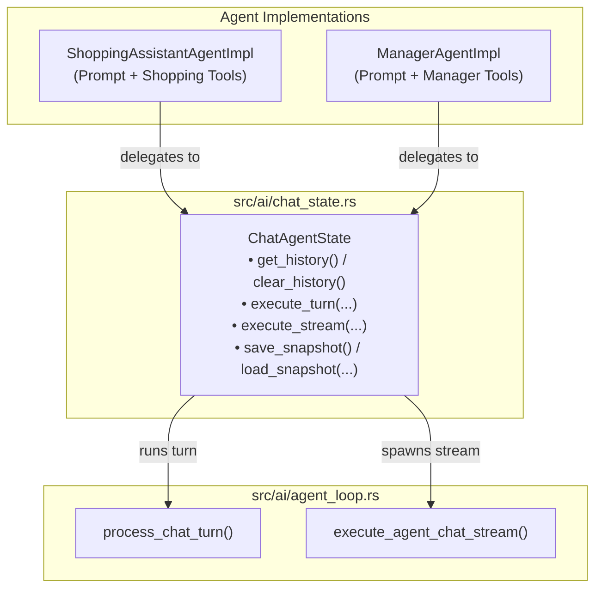

# Feature Plan: Chat Agent State Abstraction & Scaffolding Deduplication

- **Feature ID / Slug**: `chat-agent-state-abstraction`
- **Date**: 2026-11-16
- **Status**: Completed <!-- Draft | Approved | In Progress | Completed -->

---

## 1. Overview & Goals

Currently, both [`ShoppingAssistantAgent`](../../src/shopping_assistant/mod.rs) and [`ManagerAgent`](../../src/manager/mod.rs) implement identical AI chat workflows on top of Golem:
- Managing in-memory conversation history via `Arc<Mutex<Vec<ChatMessage>>>`.
- Repeating Mutex-locking and `PoisonError::into_inner` unwraps across multiple methods (`get_history`, `clear_history`, `execute_turn`, `save_snapshot`).
- Re-implementing identical non-streaming turn execution (`execute_turn` calling `process_chat_turn`).
- Re-implementing identical streaming turn execution (`chat_stream` extracting LLM configuration, creating `AgentStream`, and spawning `execute_agent_chat_stream`).
- Re-implementing snapshot persistence and restoration for chat messages.

These two agents only differ in:
1. Agent definition attributes, name, and mount path (`/v1/assistant/{id}` vs `/v1/manager/{id}`).
2. System prompt constant (`SHOPPING_ASSISTANT_SYSTEM_PROMPT` vs `MANAGER_SYSTEM_PROMPT`).
3. Tool registry construction (`build_shopping_assistant_tools(user_id)` vs `build_manager_tools()`).
4. Fallback message when the LLM API key is missing.

### Goals
1. **Create `ChatAgentState` in `src/ai/chat_state.rs`**:
   - Encapsulate `Arc<Mutex<Vec<ChatMessage>>>` and hide all locking/poison-handling details.
   - Provide clean methods for `get_history()`, `clear_history()`, `execute_turn()`, and `execute_stream()`.
   - Provide standard snapshot serialization/deserialization via a unified `ChatSnapshot { messages: Vec<ChatMessage> }`.
2. **Remove Redundant Snapshots**:
   - Remove `LegacyShoppingAssistantSnapshot` and `ShoppingAssistantSnapshot` from `src/shopping_assistant/mod.rs`.
   - Remove `ManagerSnapshot` from `src/manager/mod.rs`.
3. **Refactor `ShoppingAssistantAgentImpl` & `ManagerAgentImpl`**:
   - Replace manual mutex fields and duplicated turn orchestration with `ChatAgentState`.
   - Preserve 100% API, snapshot, and behavioral compatibility.
4. **Validation**:
   - Zero compilation errors (`cargo check --target wasm32-wasip2`).
   - Zero Clippy warnings (`cargo clippy --target wasm32-wasip2`).
   - All existing 38 unit and integration tests passing (`cargo test`), plus new unit tests for `ChatAgentState`.

### Non-Goals
- Altering the underlying AI loop (`execute_agent_chat_turn`, `execute_agent_chat_stream`).
- Changing HTTP endpoints, tool registries, or prompt definitions.
- Changing agent mount paths or public trait interfaces.

---

## 2. Technical Design & Architecture

### 2.1 Component Architecture



### 2.2 `ChatAgentState` Interface

Located in [`src/ai/chat_state.rs`](../../src/ai/chat_state.rs):

```rust
use crate::ai::agent_loop::{execute_agent_chat_stream, process_chat_turn};
use crate::ai::schema::{AgentConfig, ChatChunk, ChatMessage, ChatResponse, ChatTurnResult};
use crate::ai::tools::ToolRegistry;
use golem_rust::agentic::{AgentStream, Config, spawn_local};
use serde::{Deserialize, Serialize};
use std::sync::{Arc, Mutex, PoisonError};

#[derive(Serialize, Deserialize, Default, Clone, Debug)]
pub struct ChatSnapshot {
    #[serde(default)]
    pub messages: Vec<ChatMessage>,
}

#[derive(Clone)]
pub struct ChatAgentState {
    messages: Arc<Mutex<Vec<ChatMessage>>>,
}

impl ChatAgentState {
    pub fn new() -> Self {
        Self {
            messages: Arc::new(Mutex::new(Vec::new())),
        }
    }

    pub fn with_messages(messages: Vec<ChatMessage>) -> Self {
        Self {
            messages: Arc::new(Mutex::new(messages)),
        }
    }

    pub fn get_history(&self) -> Vec<ChatMessage> {
        self.messages
            .lock()
            .unwrap_or_else(PoisonError::into_inner)
            .clone()
    }

    pub fn clear_history(&self) {
        self.messages
            .lock()
            .unwrap_or_else(PoisonError::into_inner)
            .clear();
    }

    pub async fn execute_turn(
        &self,
        config: &Config<AgentConfig>,
        user_message: String,
        system_prompt: &str,
        no_key_message: &str,
        tools: &ToolRegistry,
    ) -> ChatTurnResult {
        let mut messages = self.get_history();
        let result = process_chat_turn(
            config,
            &mut messages,
            user_message,
            system_prompt,
            &tools.specs(),
            no_key_message,
            tools,
        )
        .await;
        *self.messages.lock().unwrap_or_else(PoisonError::into_inner) = messages;
        result
    }

    pub fn execute_stream(
        &self,
        config: &Config<AgentConfig>,
        user_message: String,
        system_prompt: &'static str,
        no_key_message: &'static str,
        tools_factory: impl FnOnce() -> ToolRegistry + Send + 'static,
    ) -> AgentStream<ChatChunk> {
        let (writer, stream) = AgentStream::new();
        let messages = self.messages.clone();
        let (api_key, model, api_url) = match config.get() {
            Ok(cfg) => (
                cfg.llm.api_key.get().unwrap_or_default(),
                cfg.llm.model.get().unwrap_or_default(),
                cfg.llm.api_url.get().ok(),
            ),
            Err(_) => (String::new(), String::new(), None),
        };
        spawn_local(async move {
            let tools = tools_factory();
            execute_agent_chat_stream(
                api_key,
                model,
                api_url,
                messages,
                user_message,
                system_prompt,
                &tools.specs(),
                no_key_message,
                &tools,
                writer,
            )
            .await;
        });
        stream
    }

    pub fn save_snapshot(&self) -> Result<Vec<u8>, String> {
        let snapshot = ChatSnapshot {
            messages: self.get_history(),
        };
        crate::common::snapshot::serialize(&snapshot)
    }

    pub fn restore_from_snapshot(bytes: &[u8]) -> Self {
        if let Ok(snapshot) = crate::common::snapshot::deserialize::<ChatSnapshot>(bytes) {
            Self::with_messages(snapshot.messages)
        } else {
            Self::new()
        }
    }
}
```

---

## 3. File-by-File Changes

| File | Change Type | Description |
| :--- | :---: | :--- |
| [`src/ai/chat_state.rs`](../../src/ai/chat_state.rs) | `[NEW]` | Encapsulates chat state, turn execution, streaming dispatch, and snapshot logic with unittests. |
| [`src/ai/mod.rs`](../../src/ai/mod.rs) | `[MODIFY]` | Re-exports `pub mod chat_state; pub use chat_state::*;`. |
| [`src/shopping_assistant/mod.rs`](../../src/shopping_assistant/mod.rs) | `[MODIFY]` | Refactor `ShoppingAssistantAgentImpl` to delegate to `ChatAgentState`; remove `ShoppingAssistantSnapshot` and `LegacyShoppingAssistantSnapshot`. |
| [`src/manager/mod.rs`](../../src/manager/mod.rs) | `[MODIFY]` | Refactor `ManagerAgentImpl` to delegate to `ChatAgentState`; remove `ManagerSnapshot`. |

---

## 4. Verification Plan

### 4.1 Automated Tool Checks
1. **Formatting**:
   ```bash
   cargo fmt --check
   ```
2. **Compilation**:
   ```bash
   cargo check --target wasm32-wasip2
   ```
3. **Clippy Linter**:
   ```bash
   cargo clippy --target wasm32-wasip2
   ```
4. **Unit Tests**:
   ```bash
   cargo test
   ```
   (Must pass all 38 existing tests plus new unit tests for `ChatAgentState`.)

---

## 5. Risks & Compatibility

- **Snapshot Compatibility**: The `ChatSnapshot` struct uses `#[serde(default)]` on `messages` and `recommended_items` so existing snapshots stored in Golem oplogs for both `ShoppingAssistantAgent` and `ManagerAgent` (including legacy snapshots) restore transparently without state loss.
- **Single-Thread Safety**: All mutex access remains safely contained inside `ChatAgentState`, ensuring zero lock leaks and preventing poison error propagation.
