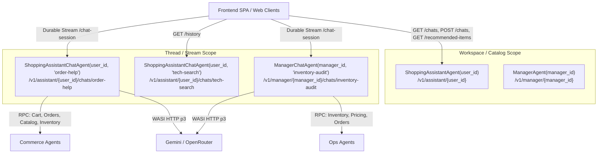

# Feature Plan: Chat-Specific Agents Architecture for Assistant and Manager

- **Feature ID / Slug**: `chat-specific-agents`
- **Date**: 2026-11-03
- **Status**: Approved

---

## 1. Overview & Goals

Currently, `ShoppingAssistantAgent` (identified by `user_id`) and `ManagerAgent` (identified by `manager_id`) combine conversation thread history, recommendations, and real-time streaming within a single agent instance.

Because Golem agents execute invocations sequentially in a single thread, an active Durable Streams connection (`chat_session`) holds an open input stream on that agent instance for its entire lifetime. Consequently, other HTTP requests to that same agent instance (such as `GET /history`, `GET /recommended-items`, or concurrent browser tabs) are enqueued behind the stream and blocked.

To resolve this cleanly without excessive complexity:
1. **Parent / Workspace Agents** (`ShoppingAssistantAgent`, `ManagerAgent`):
   - Scope: Per-user / per-manager index.
   - Responsibilities: Maintain a lightweight list of chat threads (`chats: Vec<ChatThreadSummary>`), handle thread lifecycle (`list_chats`, `create_chat`, `delete_chat`), user-level cached recommendations (`recommended_items`), and backwards-compatibility routing for legacy callers.
   - **Zero turn-by-turn callbacks**: The parent agent does not coordinate or receive notifications during message streaming, keeping the design simple and robust.
2. **Chat-Specific Agents** (`ShoppingAssistantChatAgent`, `ManagerChatAgent`):
   - Scope: Individual conversation thread, uniquely identified by `(user_id, chat_id)` or `(manager_id, chat_id)`.
   - Responsibilities: Conversation turn history, LLM context loop, tool execution, and bi-directional Durable Streams (`/chat-session`) / SSE (`/chat-stream`).

### Goals
- **Eliminate Queue Contention & Blocking**: Long-lived streams are hosted inside dedicated chat agent instances, ensuring the parent user/manager agent and other chat threads are never blocked.
- **Enable Multi-Thread Conversations**: Users and store managers can create, list, switch between, and delete discrete conversation threads (like ChatGPT / Claude threads).
- **Keep Coordination Simple**: No runtime turn callbacks or cross-agent synchronization during live chat. Each chat agent manages its own conversation turns completely independently.
- **100% Backwards Compatibility**: Legacy endpoints omitting `chat_id` automatically route to a canonical `"default"` chat thread, preserving existing integrations and tests.
- **Full-Stack Upgrades**: Update backend Rust agents, manifest (`golem.yaml`), frontend SPA (`frontend/`), and embedded web interfaces (`web/`).

### Non-Goals
- Complex inter-agent callbacks on every message.
- Full-text vector search across historical chat threads (out of scope for this milestone).

---

## 2. Architecture & Technical Design

### Agent Separation Hierarchy



### Schema & Trait Definitions

#### 1. Chat Thread Metadata (`src/ai/schema.rs`)
```rust
#[derive(Schema, Clone, Serialize, Deserialize, Debug, PartialEq, Eq)]
pub struct ChatThreadSummary {
    pub chat_id: String,
    pub title: String,
    pub created_at: String,
}

#[derive(Schema, Clone, Serialize, Deserialize, Debug, PartialEq, Eq)]
pub struct CreateChatRequest {
    pub title: Option<String>,
}
```

#### 2. Parent Assistant Agent (`ShoppingAssistantAgent`)
- **Mount Path**: `/v1/assistant/{id}` (where `{id}` is `user_id`)
- **Methods**:
  - `#[endpoint(get = "/chats")] fn list_chats(&self) -> Vec<ChatThreadSummary>`
  - `#[endpoint(post = "/chats")] fn create_chat(&mut self, req: CreateChatRequest) -> ChatThreadSummary`
  - `#[endpoint(delete = "/chats/{chat_id}")] fn delete_chat(&mut self, chat_id: String) -> bool`
  - `#[read_only] #[endpoint(get = "/recommended-items")] fn get_recommended_items(&self) -> RecommendedItems`
  - `#[endpoint(post = "/recommend-items")] async fn recommend_items(&mut self) -> bool`
  - *Backwards-compatibility proxies (forward to `chat_id = "default"`)*:
    - `#[endpoint(get = "/history")] async fn get_history(&self) -> Vec<ChatMessage>`
    - `#[endpoint(post = "/chat")] async fn chat(&mut self, message: String) -> ChatResponse`
    - `#[endpoint(post = "/clear-history")] async fn clear_history(&mut self)`

#### 3. Chat Assistant Agent (`ShoppingAssistantChatAgent`)
- **Mount Path**: `/v1/assistant/{user_id}/chats/{chat_id}`
- **Constructor**: `fn new(user_id: String, chat_id: String, #[agent_config] config: Config<AgentConfig>) -> Self`
- **Methods**:
  - `#[read_only] #[endpoint(get = "/history")] fn get_history(&self) -> Vec<ChatMessage>`
  - `#[endpoint(post = "/chat")] async fn chat(&mut self, message: String) -> ChatResponse`
  - `#[endpoint(post = "/chat-stream")] async fn chat_stream(&mut self, message: String) -> AgentStream<ChatChunk>`
  - `#[endpoint(post = "/chat-session", durable_streams(...))] fn chat_session(&mut self, input: AgentStream<ClientMessage>) -> AgentStream<ChatChunk>`
  - `#[endpoint(post = "/clear-history")] fn clear_history(&mut self)`

#### 4. Manager Workspace & Chat Agents (`ManagerAgent` & `ManagerChatAgent`)
- Symmetrical design mounted at:
  - `/v1/manager/{id}` (catalog, thread listing)
  - `/v1/manager/{manager_id}/chats/{chat_id}` (thread conversation & streaming)

---

## 3. Proposed Changes & File Impact

| Action | File Path | Description |
| :--- | :--- | :--- |
| `[MODIFY]` | [`src/ai/schema.rs`](file:///Users/coon/workspace-zv/git/golem-shopping-rust/src/ai/schema.rs) | Add `ChatThreadSummary` and `CreateChatRequest` schemas. |
| `[MODIFY]` | [`src/shopping_assistant/mod.rs`](file:///Users/coon/workspace-zv/git/golem-shopping-rust/src/shopping_assistant/mod.rs) | Implement `ShoppingAssistantChatAgent` and refactor `ShoppingAssistantAgent` to manage thread list with backwards-compatible defaults. |
| `[MODIFY]` | [`src/manager/mod.rs`](file:///Users/coon/workspace-zv/git/golem-shopping-rust/src/manager/mod.rs) | Implement `ManagerChatAgent` and refactor `ManagerAgent` to manage thread list with backwards-compatible defaults. |
| `[MODIFY]` | [`src/lib.rs`](file:///Users/coon/workspace-zv/git/golem-shopping-rust/src/lib.rs) | Export `ShoppingAssistantChatAgent`, `ShoppingAssistantChatAgentImpl`, `ManagerChatAgent`, `ManagerChatAgentImpl`. |
| `[MODIFY]` | [`golem.yaml`](file:///Users/coon/workspace-zv/git/golem-shopping-rust/golem.yaml) | Register `ShoppingAssistantChatAgent` and `ManagerChatAgent` under `httpApi.deployments.local.agents`. |
| `[MODIFY]` | [`frontend/src/api/services/assistantService.ts`](file:///Users/coon/workspace-zv/git/golem-shopping-rust/frontend/src/api/services/assistantService.ts) | Add `ChatThreadSummary`, `listAssistantChats`, `createAssistantChat`, `deleteAssistantChat`; parameterize chat endpoints with optional `chatId` (defaulting to `"default"`). |
| `[MODIFY]` | [`frontend/src/stores/assistantStore.ts`](file:///Users/coon/workspace-zv/git/golem-shopping-rust/frontend/src/stores/assistantStore.ts) | Add thread state management (`chats`, `currentChatId`, `fetchChats`, `switchChat`, `createNewChat`, `deleteChat`). |
| `[MODIFY]` | [`frontend/src/views/ShoppingAssistantView.vue`](file:///Users/coon/workspace-zv/git/golem-shopping-rust/frontend/src/views/ShoppingAssistantView.vue) | Add thread selector UI with "New Conversation", thread list, active thread highlight, and thread switching. |
| `[MODIFY]` | [`web/assets/assistant.js`](file:///Users/coon/workspace-zv/git/golem-shopping-rust/web/assets/assistant.js) | Support thread selection dropdown / new thread creation, targeting `/v1/assistant/{userId}/chats/{chatId}` while defaulting to `"default"`. |
| `[MODIFY]` | [`web/assets/manager.js`](file:///Users/coon/workspace-zv/git/golem-shopping-rust/web/assets/manager.js) | Symmetrical thread selection and management for store operations. |
| `[MODIFY]` | [`architecture.puml`](file:///Users/coon/workspace-zv/git/golem-shopping-rust/architecture.puml) | Reflect `ShoppingAssistantChatAgent` and `ManagerChatAgent` in the architecture diagram. |
| `[MODIFY]` | [`README.md`](file:///Users/coon/workspace-zv/git/golem-shopping-rust/README.md) | Document the multi-thread chat agent architecture. |

---

## 4. Verification Plan

### Automated Checks
1. **Formatting**:
   ```bash
   cargo fmt --check
   ```
2. **Compilation**:
   ```bash
   cargo check --target wasm32-wasip2
   ```
3. **Clippy Linting**:
   ```bash
   cargo clippy --target wasm32-wasip2
   ```
4. **Golem WASM Build**:
   ```bash
   golem build --yes
   ```
5. **Unit Tests**:
   ```bash
   cargo test
   ```
6. **Frontend Vite Build**:
   ```bash
   cd frontend && npx vite build
   ```

### Runtime Smoke Verification
1. **Thread Lifecycle**:
   - `POST /v1/assistant/u001/chats` creates a new chat.
   - `GET /v1/assistant/u001/chats` lists all chats.
2. **Non-Blocking Verification**:
   - An open stream on `PUT /v1/assistant/u001/chats/t1/chat-session` does NOT block `GET /v1/assistant/u001/chats` or `GET /v1/assistant/u001/chats/t2/history`.
3. **Backwards Compatibility**:
   - `GET /v1/assistant/u001/history` returns the default chat history seamlessly.
