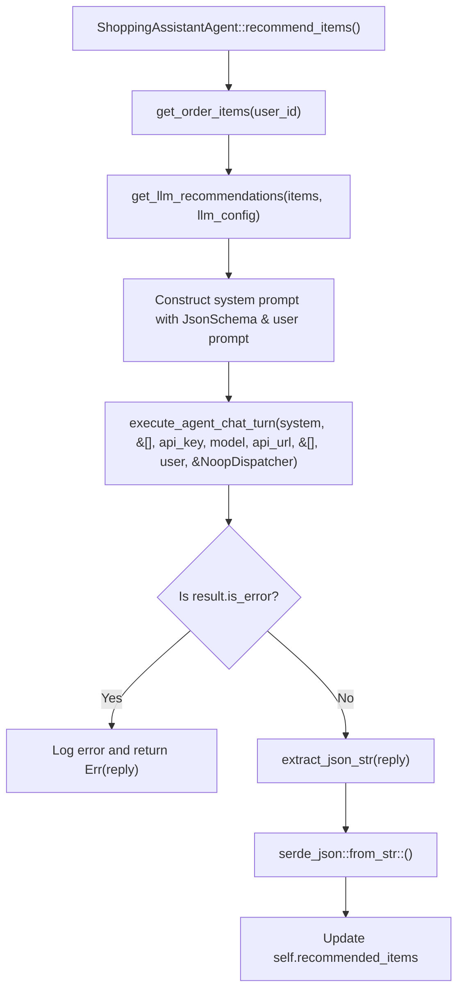

# Feature Plan: Refactor `get_llm_recommendations` to Reuse `execute_agent_chat_turn`

- **Feature ID / Slug**: `fix-get-llm-recommendations`
- **Date**: 2026-11-03
- **Status**: Completed <!-- Draft | Approved | In Progress | Completed -->

---

## 1. Overview & Goals

Currently, `get_llm_recommendations` in [`src/shopping_assistant/mod.rs`](../../src/shopping_assistant/mod.rs) uses `golem_ai_llm_openrouter::DurableOpenRouter::send` directly. Consequently:
- It only works when `OPENROUTER_KEY` and OpenRouter are configured.
- When configured for Google Gemini (e.g. `GEMINI_API_KEY`, `gemini-3.1-flash-lite`, and the Google OpenAI endpoint as in `golem.yaml`) or a custom proxy `api_url`, `recommend_items` fails.
- It uses `.expect("LLM recommendations")`, which risks panicking and permanently failing the invocation on an unhandled error instead of gracefully propagating errors.

In contrast, [`src/ai/agent_loop.rs`](../../src/ai/agent_loop.rs) provides `execute_agent_chat_turn`:
- It dynamically resolves the API endpoint via `resolve_endpoint_url` (supporting OpenRouter, Google Gemini's OpenAI-compatible endpoint, or any custom `api_url`).
- It uses Golem's native WASI HTTP client (`golem_rust::http`), which inherits Golem's built-in platform retries and durable execution semantics.
- It handles authentication, error responses, and returns a clean `ChatTurnResult`.

### Goals

1. **Reuse `execute_agent_chat_turn` for `get_llm_recommendations`**:
   - Provide a reusable `NoopDispatcher` in `src/ai/agent_loop.rs` for tool-free chat turns.
   - Call `execute_agent_chat_turn` with the structured schema system prompt and user message, passing empty tools `&[]` and history `&[]`.
   - Propagate errors gracefully without panics (`.expect`).
2. **Robust JSON Parsing**:
   - Implement a robust extraction helper `extract_json_str` that safely extracts JSON whether the LLM responds with raw JSON, markdown-wrapped code blocks (````json ... ```` or ```` ... ````), or leading/trailing commentary.
   - Deserialize the result into `LlmRecommendedItems`.
3. **Clean Up Unused Dependencies**:
   - Remove unused dependencies `golem-ai-llm` and `golem-ai-llm-openrouter` from `Cargo.toml`.
   - Remove unused imports in `src/shopping_assistant/mod.rs`.
4. **Testing**:
   - Add unit tests for JSON extraction and parsing of LLM recommendation outputs.

---

## 2. Technical Design & Architecture



### 2.1 Reusing `execute_agent_chat_turn`

`execute_agent_chat_turn` signature:
```rust
pub async fn execute_agent_chat_turn<D: ToolDispatcher>(
    system_prompt: &str,
    tools: &[ToolSpec],
    api_key: &str,
    model: &str,
    api_url: Option<&str>,
    history: &[ChatMessage],
    user_message: &str,
    missing_api_key_message: Option<&str>,
    dispatcher: &D,
) -> ChatTurnResult
```

When called from `get_llm_recommendations`:
- `system_prompt`: Formatted with JSON schema (`schema_for!(LlmRecommendedItems)`).
- `tools`: `&[]` (no tools passed).
- `api_key`: `config.api_key.get().unwrap_or_default()`
- `model`: `config.model.get().unwrap_or_default()`
- `api_url`: `config.api_url.get().ok()`
- `history`: `&[]` (isolated one-turn invocation, does not mutate assistant chat history).
- `user_message`: Prompt describing previous order items and requested counts.
- `missing_api_key_message`: Informative error message.
- `dispatcher`: `&NoopDispatcher`.

### 2.2 JSON Extraction Helper

```rust
pub fn extract_json_str(text: &str) -> &str {
    let trimmed = text.trim();
    if let Some(start) = trimmed.find("```json") {
        let after_fence = &trimmed[start + 7..];
        if let Some(end) = after_fence.rfind("```") {
            return after_fence[..end].trim();
        }
    } else if let Some(start) = trimmed.find("```") {
        let after_fence = &trimmed[start + 3..];
        if let Some(end) = after_fence.rfind("```") {
            return after_fence[..end].trim();
        }
    }

    if let (Some(first_brace), Some(last_brace)) = (trimmed.find('{'), trimmed.rfind('}')) {
        if first_brace <= last_brace {
            return &trimmed[first_brace..=last_brace];
        }
    }

    trimmed
}
```

---

## 3. File-by-File Changes

| File | Action | Description |
|---|---|---|
| [`src/ai/agent_loop.rs`](../../src/ai/agent_loop.rs) | `[MODIFY]` | Add `pub struct NoopDispatcher` and `pub fn extract_json_str(text: &str) -> &str` (with unit tests). |
| [`src/shopping_assistant/mod.rs`](../../src/shopping_assistant/mod.rs) | `[MODIFY]` | Refactor `get_llm_recommendations` to call `execute_agent_chat_turn`, remove `golem_ai_llm_openrouter` references, remove `.expect`, and parse using `extract_json_str`. |
| [`Cargo.toml`](../../Cargo.toml) | `[MODIFY]` | Remove unused `golem-ai-llm` and `golem-ai-llm-openrouter` crate dependencies. |

---

## 4. Verification Plan

1. **Compilation Check**:
   ```shell
   cargo check --target wasm32-wasip2
   ```
2. **Formatting and Linting**:
   ```shell
   cargo fmt --check
   cargo clippy --target wasm32-wasip2
   ```
3. **Unit Tests**:
   ```shell
   cargo test
   ```
4. **Golem Component Build**:
   ```shell
   golem build --yes
   ```

