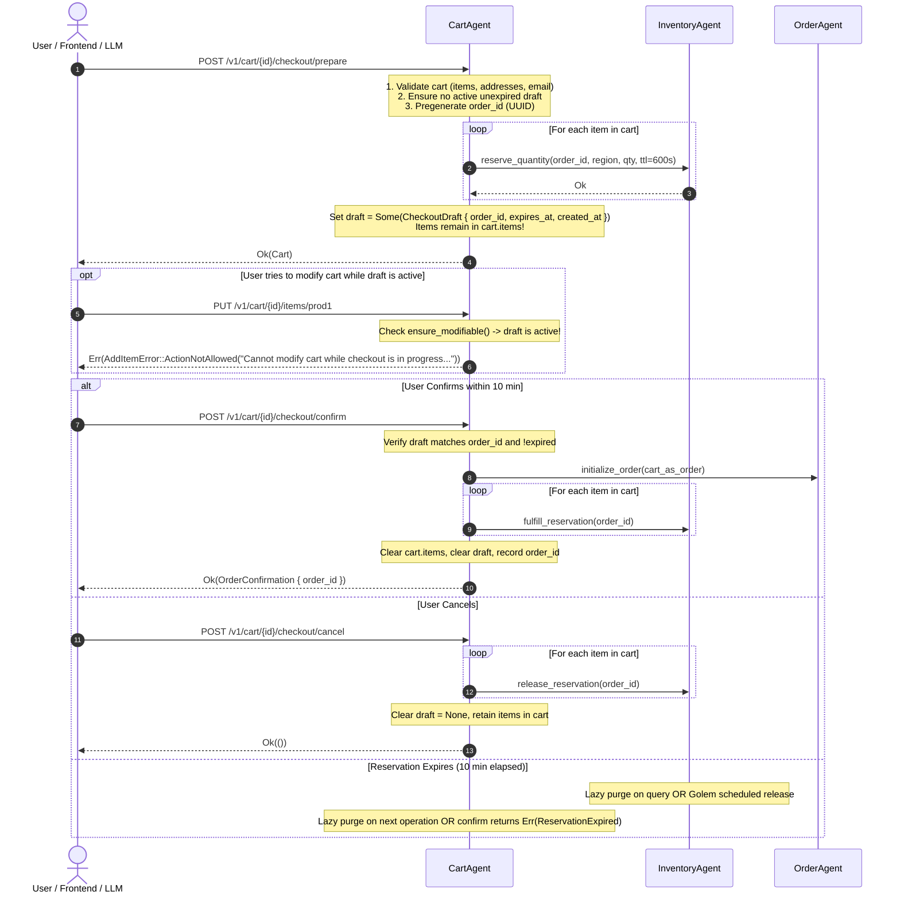

# Feature Plan: Two-Phase Checkout with Inventory Reservation & Expiration

- **Feature ID / Slug**: `prepare-confirm-checkout`
- **Date**: 2026-11-05
- **Status**: Completed <!-- Draft | Approved | In Progress | Completed -->

---

## 1. Overview & Goals

Transition the shopping checkout flow from a single-turn, immediate `checkout()` operation to an enterprise-grade **Two-Phase Checkout (`prepare_checkout` $\to$ `confirm_checkout`)** with time-bounded inventory reservation. 

This directly solves the AI safety, concurrency, and validation problems when agents and frontends interact with e-commerce:
1. **Concurrency / Stock Guarantees**: Stock is reserved in `InventoryAgent` for 10 minutes during `prepare_checkout`, guaranteeing items won't be sold out while the user reads the summary.
2. **Deterministic Human-in-the-Loop (HITL)**: The agent *must* call `prepare_checkout` first to obtain an `order_id` and activate `draft: Option<CheckoutDraft>`. It cannot execute `confirm_checkout` without user confirmation and an unexpired reservation.
3. **Strict Invariant & Cart Locking**: While a checkout draft is active and unexpired, modifying the cart returns `ActionNotAllowedError`, preventing data races and inconsistent orders.
4. **Zero Data Redundancy**: Cart items, totals, and addresses remain in `Cart`. `CheckoutDraft` is lightweight, holding only reservation metadata (`order_id`, `expires_at`, `created_at`).
5. **Frontend Transparency**: The web checkout UI and chat assistant clearly communicate the active reservation, display a live countdown timer, and provide explicit confirmation and cancellation controls.

### Goals

- Extend `InventoryAgent` with time-to-live (`ttl_seconds`), `expires_at` timestamps on allocations, and auto-cleanup (lazy purge + Golem self-scheduling).
- Upgrade `Cart` with a lightweight `draft: Option<CheckoutDraft>`.
- Add `ActionNotAllowedError` to cart mutation errors (`AddItemError`, `RemoveItemError`, `UpdateItemQuantityError`, `UpdateAddressError`, `UpdateEmailError`, `PrepareCheckoutError`).
- Add `prepare_checkout()`, `confirm_checkout(order_id)`, and `cancel_checkout(order_id)` to `CartAgent`.
- Update `ShoppingAssistantAgent` tools (`prepare_checkout`, `confirm_checkout`, `cancel_checkout`) and system prompt.
- Update frontend (`cartService`, `cartStore`, `CheckoutView.vue`, and `assistantStore`) to support reservation review, expiration countdown, and confirmation.

### Non-Goals

- Replacing the payment gateway integration (mock payment remains valid).
- Multi-warehouse routing algorithms (inventory continues using regional availability).

---

## 2. Architecture & Technical Design



### Key Decisions

1. **Lightweight `CheckoutDraft`**:
   - `CheckoutDraft` only tracks reservation metadata: `order_id`, `expires_at`, `created_at`.
   - Items, totals, addresses, and email stay in `Cart` fields. Zero duplication.
   - When `draft` is `None` (or expired), cart is in normal shopping mode. When `Some` (and `expires_at > now`), cart is in checkout mode.
   - `Cart.items` are **only emptied** when `confirm_checkout` succeeds. They are retained if cancelled or expired.

2. **Cart Locking via `ActionNotAllowedError` & Price Freezing**:
   - Consistent with `OrderAgent` convention in `src/order/mod.rs`.
   - **`get_cart(&mut self)` freeze**: If `cart.is_in_checkout()` is true, `get_cart()` **skips price/product re-fetching and mutations**, returning the exact frozen cart state as prepared. When in normal shopping mode (`draft` is `None` or expired), it refreshes product prices as usual.
   - All mutation operations (`add_item`, `update_item_quantity`, `remove_from_cart`, `clear_cart`, `set_shipping_address`, `set_billing_address`, `set_email`) call `self.ensure_modifiable()`.
   - If an unexpired draft is active, returns `ActionNotAllowed(ActionNotAllowedError)`.
   - If draft is expired, `purge_expired_draft()` lazily unlocks the cart.

3. **Atomic Inventory Reservation**:
   - If reservation fails for any item in `prepare_checkout`, all already-reserved items in that batch are immediately released before returning `InsufficientStock`.

4. **Tool Separation for LLM**:
   - Replace `checkout_cart` tool with `prepare_checkout`, `confirm_checkout(orderId)`, and `cancel_checkout(orderId)`.
   - The assistant presents the summary and asks for explicit confirmation before calling `confirm_checkout`.

---

## 3. Proposed Changes & File Impact

| Action     | File Path | Description |
| :--------- | :-------- | :---------- |
| `[MODIFY]` | [`src/inventory/mod.rs`](../../src/inventory/mod.rs) | Add `expires_at` to `OrderAllocation`, add `purge_expired_allocations()`, update `reserve_quantity` with TTL support |
| `[MODIFY]` | [`src/cart/mod.rs`](../../src/cart/mod.rs) | Add `CheckoutDraft`, `ActionNotAllowedError`, `prepare_checkout`, `confirm_checkout`, `cancel_checkout`, guard cart mutations |
| `[MODIFY]` | [`src/shopping_assistant/tools.rs`](../../src/shopping_assistant/tools.rs) | Replace `checkout_cart` tool with `prepare_checkout`, `confirm_checkout`, `cancel_checkout`, update system prompt |
| `[MODIFY]` | [`frontend/src/api/services/cartService.ts`](../../frontend/src/api/services/cartService.ts) | Add `CheckoutDraft` type, add `prepareCheckout`, `confirmCheckout`, and `cancelCheckout` API calls |
| `[MODIFY]` | [`frontend/src/stores/cartStore.ts`](../../frontend/src/stores/cartStore.ts) | Add `isCheckoutActive` computed helper, actions for prepare, confirm, and cancel checkout |
| `[MODIFY]` | [`frontend/src/views/CheckoutView.vue`](../../frontend/src/views/CheckoutView.vue) | 2-step checkout UI: review step with 10-minute countdown timer and confirm/cancel buttons |
| `[MODIFY]` | [`frontend/src/views/CartView.vue`](../../frontend/src/views/CartView.vue) | Show active checkout banner when `isCheckoutActive` is true, disable or warn on item mutations |
| `[MODIFY]` | [`frontend/src/stores/assistantStore.ts`](../../frontend/src/stores/assistantStore.ts) | Add `prepare_checkout`, `confirm_checkout`, `cancel_checkout` to cart-mutating tool watchers |

---

## 4. Detailed Component Changes

### 1. `src/inventory/mod.rs`
- Add `pub expires_at: Option<chrono::DateTime<chrono::Utc>>` to `OrderAllocation`.
- Implement `Inventory::purge_expired_allocations(&mut self)` to remove allocations where `expires_at.is_some() && expires_at.unwrap() <= Utc::now()`.
- Call `purge_expired_allocations` inside `get_available_quantity` and `reserve_quantity`.
- Update `reserve_quantity` signature:
  ```rust
  fn reserve_quantity(
      &mut self,
      order_id: String,
      region: String,
      quantity: u32,
      ttl_seconds: Option<u64>,
  ) -> Result<(), ReserveQuantityError>;
  ```

### 2. `src/cart/mod.rs`
- Define lightweight `CheckoutDraft`:
  ```rust
  #[derive(Schema, Clone, Serialize, Deserialize, Debug, PartialEq)]
  pub struct CheckoutDraft {
      pub order_id: String,
      pub expires_at: chrono::DateTime<chrono::Utc>,
      pub created_at: chrono::DateTime<chrono::Utc>,
  }
  ```
- Update `Cart` struct:
  ```rust
  #[derive(Schema, Clone, Serialize, Deserialize)]
  pub struct Cart {
      pub user_id: String,
      pub email: Option<String>,
      pub items: Vec<CartItem>,
      pub billing_address: Option<Address>,
      pub shipping_address: Option<Address>,
      pub total: f32,
      pub currency: String,
      pub previous_order_ids: Vec<String>,
      pub updated_at: chrono::DateTime<chrono::Utc>,
      /// Lightweight draft: presence + unexpired = in checkout mode
      pub draft: Option<CheckoutDraft>,
  }
  ```
- Add `ActionNotAllowedError`:
  ```rust
  #[derive(Schema, Clone, Serialize, Deserialize, Debug)]
  pub struct ActionNotAllowedError {
      pub message: String,
  }
  ```
- Add `ActionNotAllowed(ActionNotAllowedError)` to:
  - `AddItemError`
  - `RemoveItemError`
  - `UpdateItemQuantityError`
  - `UpdateAddressError`
  - `UpdateEmailError`
- Add Cart methods:
  - `pub fn purge_expired_draft(&mut self)`: Clears `draft` if `expires_at <= Utc::now()`.
  - `pub fn ensure_modifiable(&mut self) -> Result<(), ActionNotAllowedError>`: Calls `purge_expired_draft()`, returns `Err(ActionNotAllowedError)` if `draft.is_some()`.
  - `pub fn is_in_checkout(&self) -> bool`: Checks if `draft` exists and `expires_at > Utc::now()`.
- Update `get_cart(&mut self) -> Option<Cart>`:
  - First calls `cart.purge_expired_draft()`.
  - If `cart.is_in_checkout()` is true, **returns `Some(cart.clone())` immediately without modifying `cart.items` or re-fetching pricing**, keeping the prepared checkout state completely frozen.
  - If `cart.draft` is `None` (or was purged), proceeds with normal dynamic price and product refresh.
- Define `PrepareCheckoutError` and `ConfirmCheckoutError`:
  ```rust
  #[derive(Schema, Clone, Serialize, Deserialize, Debug)]
  pub enum PrepareCheckoutError {
      EmptyCart,
      MissingEmail,
      MissingShippingAddress,
      MissingBillingAddress,
      ActionNotAllowed(ActionNotAllowedError),
      InsufficientStock(Vec<InsufficientStockError>),
      PricingError(String),
  }

  #[derive(Schema, Clone, Serialize, Deserialize, Debug)]
  pub enum ConfirmCheckoutError {
      NoActiveDraft,
      OrderMismatch,
      ReservationExpired,
      OrderCreate(OrderCreateError),
  }
  ```
- Add methods to `CartAgent`:
  - `async fn prepare_checkout(&mut self) -> Result<Cart, PrepareCheckoutError>`
  - `async fn confirm_checkout(&mut self, order_id: String) -> Result<OrderConfirmation, ConfirmCheckoutError>`
  - `async fn cancel_checkout(&mut self, order_id: String) -> Result<(), String>`

### 3. `src/shopping_assistant/tools.rs`
- Register `prepare_checkout`:
  - Description: *"Validates cart, reserves items in inventory for 10 minutes, and locks total price. MUST be called first when user wants to checkout. Present the summary and ask for user confirmation."*
- Register `confirm_checkout`:
  - Parameters: `{ "orderId": { "type": "string" } }`
  - Description: *"Places the order using the pregenerated order ID from prepare_checkout. ONLY call this when the user has explicitly confirmed the prepared order summary."*
- Register `cancel_checkout`:
  - Parameters: `{ "orderId": { "type": "string" } }`
  - Description: *"Cancels an active checkout reservation and unlocks the cart so items or addresses can be modified."*
- Update `SHOPPING_ASSISTANT_SYSTEM_PROMPT` to guide the assistant through this two-stage interaction.

### 4. Frontend: `CheckoutView.vue`, `CartView.vue` & `cartStore.ts`
- In `cartStore.ts`:
  - Track `isCheckoutActive = computed(() => !!cart.value?.draft && new Date(cart.value.draft.expires_at) > new Date())`.
  - Provide `prepareCheckout(userId)`, `confirmCheckout(userId, orderId)`, and `cancelCheckout(userId, orderId)`.
- In `CheckoutView.vue`:
  - First stage: "Contact & Shipping Details" $\to$ User clicks "Reserve & Review Order".
  - Second stage: "Order Reservation Active" $\to$ Displays a live 10-minute timer (`MM:SS`), items breakdown, and two actions:
    - **[Place Order Now]**: Invokes `cartStore.confirmCheckout(userId, orderId)` $\to$ Navigates to `/order/:id`.
    - **[Cancel / Modify Cart]**: Invokes `cartStore.cancelCheckout(userId, orderId)` $\to$ Releases reservation, returns to cart edit mode.
- In `CartView.vue`:
  - Displays banner when `isCheckoutActive`: *"Checkout in progress for Order #... (Expires in MM:SS) [Continue Checkout] [Cancel Reservation]"*.
  - Disables quantity adjustments while checkout is active, directing user to cancel checkout first.

---

## 5. Verification Plan

### Automated Checks
- Code formatting check:
  ```bash
  cargo fmt --check
  ```
- Type checking & compilation for WebAssembly target:
  ```bash
  cargo check --target wasm32-wasip2
  ```
- Clippy linter:
  ```bash
  cargo clippy --target wasm32-wasip2
  ```
- Golem Component Build:
  ```bash
  golem build --yes
  ```
- Unit & integration tests:
  ```bash
  cargo test
  ```

### Manual / Integration Verification
1. **Cart Preparation & Reservation**:
   - Add product to cart.
   - Invoke `prepare_checkout`.
   - Verify `cart.draft` is populated with `order_id` and `expires_at`.
   - Verify `InventoryAgent` shows available quantity decreased by reserved amount.
2. **Cart Invariant (Locking)**:
   - Attempt to call `add_item` while draft is active $\to$ Verify `ActionNotAllowed` is returned.
3. **Confirmation**:
   - Invoke `confirm_checkout(order_id)`.
   - Verify order is created in `OrderAgent`, `cart.items` and `cart.draft` are cleared, and inventory allocations are permanently fulfilled.
4. **Cancellation**:
   - Prepare checkout, then invoke `cancel_checkout(order_id)`.
   - Verify `cart.draft` is cleared, `cart.items` remain intact, and inventory availability is restored.
5. **Expiration**:
   - Prepare a checkout, wait for TTL to expire, attempt `confirm_checkout` $\to$ verify it returns `ReservationExpired` error.
   - Check `InventoryAgent` availability $\to$ verify available quantity restored to original level.
6. **Shopping Assistant Natural Chat**:
   - Send: *"I want to buy the items in my cart"*.
   - Verify assistant runs `prepare_checkout` and replies with summary and asks for confirmation.
   - Send: *"Yes, place the order"*.
   - Verify assistant calls `confirm_checkout(order_id)` and gives the confirmation receipt.

---

## 6. Risks & Open Questions

- **Backward Compatibility**: Existing clients calling `/v1/cart/{id}/checkout` can be preserved as an internal alias that executes `prepare_checkout()` followed immediately by `confirm_checkout()`, preventing breaking changes for legacy tests or endpoints.
- **TTL Duration**: 10 minutes (600 seconds) is configured as standard.
