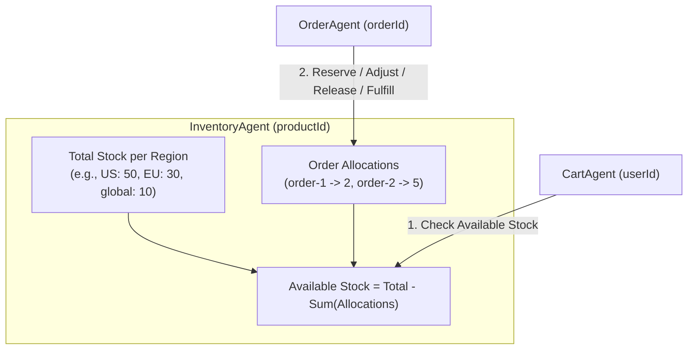
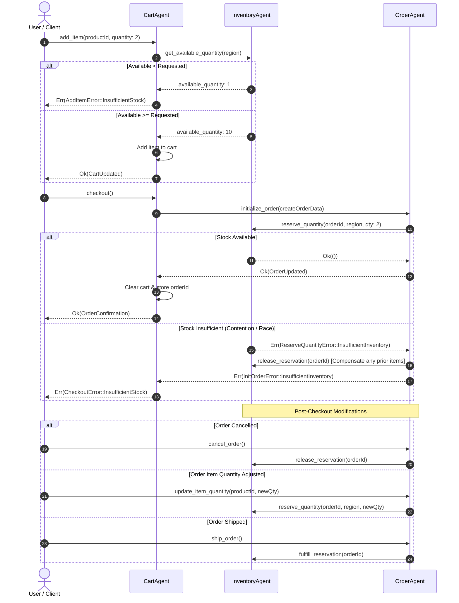

# Feature Plan: Per-Product Regional Inventory Management

- **Feature ID / Slug**: `product-inventory`
- **Date**: 2026-11-02
- **Status**: Completed <!-- Draft | Approved | In Progress | Completed -->

---

## 1. Overview & Goals

This feature introduces durable, region-aware inventory management to the Golem Shopping Rust application, mirroring the architecture established in `golem-shopping-effect`. Similar to `PricingAgent`, each product will have its own dedicated durable `InventoryAgent` identified by `productId`, tracking stock quantities across geographic regions (e.g., `"global"`, `"us"`, `"eu"`).

### Core Goals

1. **Per-Product Durable Inventory Agent (`InventoryAgent`)**:
   - A durable Golem agent instantiated per `productId` (`/v1/inventory/{id}`).
   - Manages base/total inventory levels partitioned by `region`.
   - Explicitly records and tracks order allocations/reservations per `orderId`.
   - Supports snapshot persistence (`load_snapshot` / `save_snapshot`).
2. **Cart Stock Validation**:
   - Soft inventory availability validation during `addItem` and `updateItemQuantity` in `CartAgent`.
   - Prevents adding or incrementing item quantities beyond available regional stock.
   - Transparent error reporting (`InsufficientStockError`) indicating requested vs available stock.
3. **Checkout & Order Lifecycle Coordination**:
   - **Hard Reservation on Order Creation**: In `OrderAgent.initialize_order`, atomically reserves inventory for each order line item.
   - **Saga Compensation**: If reserving inventory for any line item fails, all previously reserved items within that order are rolled back and released asynchronously via fire-and-forget `trigger_release_reservation`.
   - **Post-Checkout Order Modifications**:
     - `addItem`: reserves stock for the newly added item under the order.
     - `updateItemQuantity`: adjusts the allocated quantity up or down for the order.
     - `removeItem`: releases the reservation for that product back to available stock via `trigger_release_reservation`.
     - `cancelOrder`: releases all reserved allocations for the order via `trigger_release_reservation`.
     - `shipOrder`: fulfills the reservation via `trigger_fulfill_reservation` (deducts total stock and clears the order allocation).
4. **Data Import & Seeding**:
   - Incorporate `data/fixtures/tech_inventory.csv` seeding initial stock of 10 items for each product in the `"global"` region.
   - Update `data/import.yaml` with an inventory creation step and update `data/README.md`.
5. **System Architecture & Documentation**:
   - Update `golem.yaml` with `InventoryAgent` under the `httpApi` deployment.
   - Update `architecture.puml` with `InventoryAgent`, gateway route `/v1/inventory/**`, and RPC communication edges.
   - Update `README.md` to document `InventoryAgent`.

### Non-Goals

- Warehouse tracking, multiple fulfillment center splits within a single region, or backorder waitlists.
- Modifying frontend views (handled separately in frontend tasks).

---

## 2. Architecture & Technical Design

### 2.1 Inventory State & Quantity Math

For a given product and region:
- **Total Stock ($Q_{total}$)**: Base stock allocated to that region.
- **Allocations ($A_{order}$)**: Quantity currently reserved by active orders (`orderId -> quantity`).
- **Allocated Stock ($Q_{allocated}$)**: $\sum_{\text{orders}} A_{\text{order}}$.
- **Available Stock ($Q_{available}$)**: $\max(0, Q_{total} - Q_{allocated})$.

When reserving for an existing order (`orderId`):
- Other allocated stock $Q_{other} = \sum_{o \neq \text{orderId}} A_{o}$.
- Available for this order $Q_{\text{avail\_order}} = \max(0, Q_{total} - Q_{other})$.
- If requested $Q_{req} \le Q_{\text{avail\_order}}$, the reservation is accepted and the allocation for `orderId` is updated.



### 2.2 Sequence Diagram: Cart & Order Lifecycle



### 2.3 Key Decisions & Rationale

1. **Durable Agent per Product (`InventoryAgent`)**:
   - Matches `PricingAgent` and `ProductAgent` patterns.
   - Product-level granularity eliminates contention between different products while ensuring sequential consistency for single-product stock operations without locks.
2. **Soft Reservation in Cart vs. Hard Reservation in Order**:
   - `CartAgent` performs a read query `get_available_quantity` to avoid stale cart abandonments locking up inventory.
   - `OrderAgent` performs authoritative `reserve_quantity` when checkout commences.
3. **Saga Compensation for Multi-Item Orders**:
   - If an order has 3 items and item #3 fails reservation, items #1 and #2 are immediately released via `release_reservation`.
4. **Snapshot Persistence**:
   - `InventoryAgentImpl` implements `load_snapshot` and `save_snapshot` using `crate::common::snapshot::{serialize, deserialize}` for seamless recovery and oplog compaction.
5. **Region Usage**:
   - Uses `INVENTORY_REGION_DEFAULT = "global"` directly for inventory checks and reservations across cart and order operations (matching `PRICING_REGION_DEFAULT`).

---

## 3. Proposed Changes & File Impact

| Action | File Path | Description |
| :--- | :--- | :--- |
| `[NEW]` | [`src/inventory/mod.rs`](../../src/inventory/mod.rs) | `InventoryAgent` definition, schemas, quantity math, snapshotting, and unit tests. |
| `[MODIFY]` | [`src/lib.rs`](../../src/lib.rs) | Register and export `pub mod inventory;`. |
| `[MODIFY]` | [`src/common/mod.rs`](../../src/common/mod.rs) | Export `pub const INVENTORY_REGION_DEFAULT: &str = "global";`. |
| `[MODIFY]` | [`src/cart/mod.rs`](../../src/cart/mod.rs) | Add `InsufficientStockError`, integrate stock validation into `add_item` and `update_item_quantity`. |
| `[MODIFY]` | [`src/order/mod.rs`](../../src/order/mod.rs) | Add `InsufficientInventoryError`, integrate reservation, compensation, release, and fulfillment into order lifecycle. |
| `[MODIFY]` | [`golem.yaml`](../../golem.yaml) | Register `InventoryAgent` in `httpApi.deployments.local.agents`. |
| `[MODIFY]` | [`data/import.yaml`](../../data/import.yaml) | Add Drill import plan step for tech inventory. |
| `[MODIFY]` | [`data/README.md`](../../data/README.md) | Document inventory fixtures and import step. |
| `[MODIFY]` | [`architecture.puml`](../../architecture.puml) | Add `InventoryAgent` component, endpoint notes, and interaction arrows. |
| `[MODIFY]` | [`README.md`](../../README.md) | Document `Inventory Agent` in application overview and agent list. |

---

### Detailed Changes

#### 1. `src/inventory/mod.rs` `[NEW]`
- **Schemas**:
  - `InventoryItem`: `pub region: String`, `pub total_quantity: u32`
  - `OrderAllocation`: `pub order_id: String`, `pub region: String`, `pub quantity: u32`, `pub updated_at: DateTime<Utc>`
  - `Inventory`: `pub product_id: String`, `pub items: Vec<InventoryItem>`, `pub allocations: Vec<OrderAllocation>`, `pub created_at: DateTime<Utc>`, `pub updated_at: DateTime<Utc>`
  - `Availability`: `pub product_id: String`, `pub region: String`, `pub available_quantity: u32`, `pub total_quantity: u32`, `pub allocated_quantity: u32`
  - `InsufficientInventoryError`: `message: String`, `product_id: String`, `region: String`, `requested: u32`, `available: u32`
  - `InventoryNotFoundError`: `message: String`, `product_id: String`
  - `ReserveQuantityError`: `InsufficientInventory(InsufficientInventoryError)`, `InventoryNotFound(InventoryNotFoundError)`
- **Agent Trait**:
  ```rust
  #[agent_definition(mount = "/v1/inventory/{id}")]
  pub trait InventoryAgent {
      fn new(id: String) -> Self;

      #[endpoint(get = "/")]
      fn get_inventory(&self) -> Option<Inventory>;

      #[endpoint(get = "/availability?region={region}")]
      fn get_available_quantity(&self, region: String) -> Availability;

      #[endpoint(post = "/")]
      fn initialize_inventory(&mut self, items: Vec<InventoryItem>);

      #[endpoint(put = "/")]
      fn update_inventory(&mut self, items: Vec<InventoryItem>);

      fn reserve_quantity(
          &mut self,
          order_id: String,
          region: String,
          quantity: u32,
      ) -> Result<(), ReserveQuantityError>;

      fn release_reservation(&mut self, order_id: String);

      fn fulfill_reservation(&mut self, order_id: String);
  }
  ```
- **Agent Implementation**:
  - `initialize_inventory`: initializes regional quantities, resets allocations, sets `created_at` and `updated_at`.
  - `update_inventory`: merges regional items, updates `updated_at`.
  - `get_inventory`: returns cloned `Option<Inventory>`.
  - `get_available_quantity`: calculates `total_quantity`, `allocated_quantity`, and `available_quantity = max(0, total - allocated)`.
  - `reserve_quantity`: verifies inventory exists, verifies available quantity considering existing allocation for `order_id`, updates/replaces allocation or returns `ReserveQuantityError`.
  - `release_reservation`: filters out allocations for `order_id`.
  - `fulfill_reservation`: deducts allocated quantities from regional totals and removes allocations for `order_id`.
  - `load_snapshot` / `save_snapshot`: persistence support using `crate::common::snapshot`.
- **Unit Tests**:
  - In-memory logic tests for stock merge, reservation limits, order updates, release, and fulfillment.

#### 2. `src/lib.rs` `[MODIFY]`
- Add `pub mod inventory;`.

#### 3. `src/common/mod.rs` `[MODIFY]`
- Add `pub const INVENTORY_REGION_DEFAULT: &str = "global";`.

#### 4. `src/cart/mod.rs` `[MODIFY]`
- Define `InsufficientStockError { pub message: String, pub product_id: String, pub requested: u32, pub available: u32 }`.
- Add `InsufficientStock(InsufficientStockError)` variant to `AddItemError`, `UpdateItemQuantityError`, and `CheckoutError`.
- In `add_item(product_id, quantity)`:
  - Query `InventoryAgentClient::get(product_id).get_available_quantity(region)`.
  - If `(existing_cart_quantity + quantity) > available_quantity`, return `Err(AddItemError::InsufficientStock(...))`.
- In `update_item_quantity(product_id, quantity)`:
  - Query `InventoryAgentClient::get(product_id).get_available_quantity(region)`.
  - If `quantity > available_quantity`, return `Err(UpdateItemQuantityError::InsufficientStock(...))`.
- In `checkout()` / `create_order()`:
  - Propagate `InsufficientStock` if `OrderAgent.initialize_order` fails due to insufficient inventory.

#### 5. `src/order/mod.rs` `[MODIFY]`
- Define `InsufficientInventoryError { pub message: String, pub product_id: String, pub requested: u32, pub available: u32 }`.
- Add `InsufficientInventory(InsufficientInventoryError)` variant to `InitOrderError`, `AddItemError`, and `UpdateItemQuantityError`.
- In `initialize_order(data)`:
  - Make `async fn initialize_order(&mut self, data: CreateOrder) -> Result<OrderUpdated, InitOrderError>`.
  - Reserve stock for each item in `data.items`.
  - If any reservation fails: compensate by calling `release_reservation(order_id)` for all items previously reserved in this loop, and return `Err(InitOrderError::InsufficientInventory(...))`.
- In `add_item(product_id, quantity)`:
  - Call `reserve_quantity(order_id, region, new_qty).await`. If fails, return error.
- In `update_item_quantity(product_id, quantity)`:
  - Make async, call `reserve_quantity(order_id, region, quantity).await`.
- In `remove_item(product_id)`:
  - Make async, call `release_reservation(order_id).await` for that product.
- In `cancel_order()`:
  - Make async, call `release_reservation(order_id).await` for all items in the order.
- In `ship_order()`:
  - Make async, call `fulfill_reservation(order_id).await` for all items in the order.

#### 6. `golem.yaml` `[MODIFY]`
- Add `InventoryAgent: {}` to `httpApi.deployments.local.agents`.

#### 7. `data/import.yaml` and `data/README.md` `[MODIFY]`
- Add `Create tech inventory, index {{ index }}` step using `./fixtures/tech_inventory.csv` targeting `/v1/inventory/{{ item.product_id }}` via `POST`.
- Update `data/README.md` to document the new inventory fixtures and import step.

#### 8. `architecture.puml` and `README.md` `[MODIFY]`
- Add `[Inventory Agent] as inventory #D5F5E3` and RPC communication arrows in `architecture.puml`.
- Add gateway route `• /v1/inventory/** → Inventory Agent`.
- Update `README.md` with `Inventory Agent` description.

---

## 4. Verification Plan

### Automated Checks

1. **Code Formatting**:
   ```bash
   cargo fmt --check
   ```
   Ensures compliance with Rust code style.

2. **Compilation & Type Check**:
   ```bash
   cargo check --target wasm32-wasip2
   ```
   Ensures zero compilation or type errors for the WebAssembly target.

3. **Linter (Clippy)**:
   ```bash
   cargo clippy --target wasm32-wasip2
   ```
   Ensures code conforms to Rust idiomatic best practices without errors or warnings.

4. **Golem Component Build**:
   ```bash
   golem build --yes
   ```
   Verifies that the WASM component bundle and Golem agent bindings build cleanly.

5. **Automated Unit Tests**:
   ```bash
   cargo test --lib inventory
   ```
   Runs dedicated unit tests for inventory state transitions, availability calculations, and reservation limits.

### Manual & Integration Verification

1. **Inventory Initialization & Query**:
   ```bash
   # Initialize inventory for product ap001
   curl -X POST http://localhost:9006/v1/inventory/ap001 \
     -H "Content-Type: application/json" \
     -d '{"items": [{"region": "global", "total_quantity": 10}]}'

   # Query available quantity
   curl http://localhost:9006/v1/inventory/ap001/availability?region=global
   # Expect: {"available_quantity": 10, "total_quantity": 10, "allocated_quantity": 0, ...}
   ```

2. **Cart Stock Validation**:
   ```bash
   # Attempt to add 15 units when only 10 available
   curl -X PUT http://localhost:9006/v1/cart/user-1/items/ap001 \
     -H "Content-Type: application/json" \
     -d '{"quantity": 15}'
   # Expect error: InsufficientStock (requested: 15, available: 10)

   # Add 5 units (valid)
   curl -X PUT http://localhost:9006/v1/cart/user-1/items/ap001 \
     -H "Content-Type: application/json" \
     -d '{"quantity": 5}'
   # Expect: CartUpdated
   ```

3. **Checkout Reservation & Order Lifecycle**:
   - Set cart email and billing address, then checkout.
   - Inspect `curl http://localhost:9006/v1/inventory/ap001/availability?region=global` $\rightarrow$ Expect `allocated_quantity: 5`, `available_quantity: 5`.
   - Ship order $\rightarrow$ Inspect inventory: `total_quantity: 5`, `allocated_quantity: 0`, `available_quantity: 5`.
   - Or Cancel order $\rightarrow$ Inspect inventory: `total_quantity: 10`, `allocated_quantity: 0`, `available_quantity: 10`.

---

## 5. Risks & Open Questions

- **Risk: Asynchronous Agent Signatures**:
  - Updating `initialize_order`, `update_item_quantity`, `remove_item`, `cancel_order`, and `ship_order` to `async fn` is supported by Golem SDK `agent_definition` (as seen in `add_item` in `CartAgent` and `OrderAgent`). We will ensure all caller sites correctly `.await` these invocations.
- **Risk: Snapshot Backward Compatibility**:
  - Since this is a new agent and the application runs in local/dev mode on this branch, `InventoryAgent` state snapshot starts cleanly at version 1.
- **Open Questions**:
  - None at this stage. All requirements align with the reference implementation in `golem-shopping-effect`.

